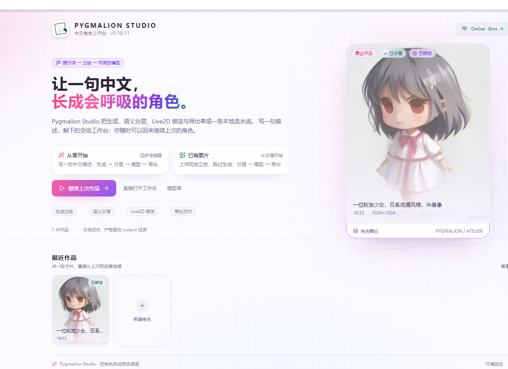
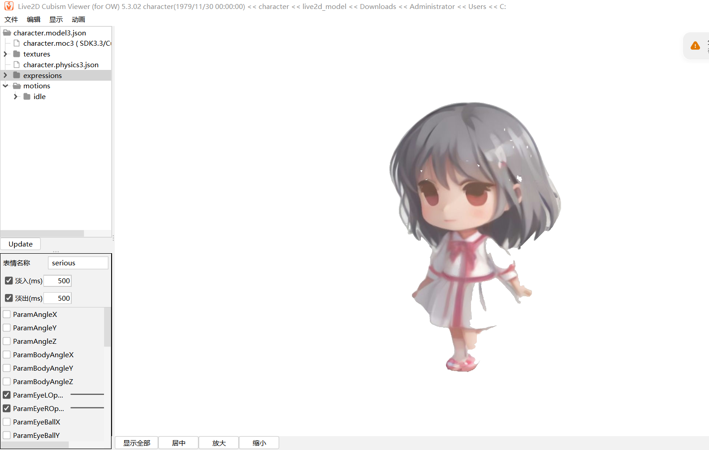
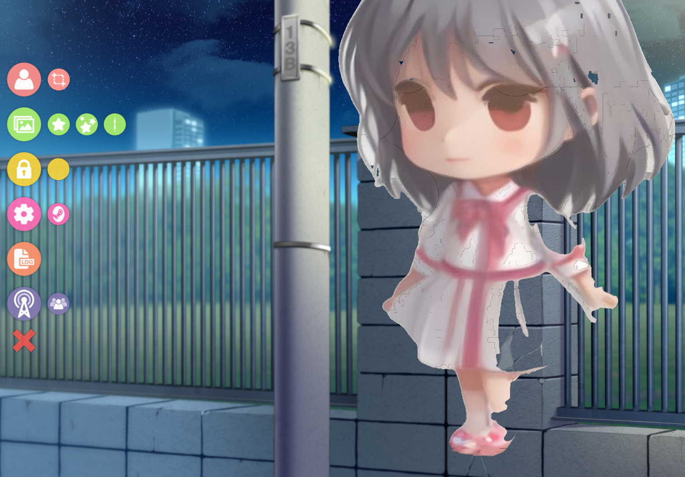

<p align="center">
  
</p>

<h1 align="center">Pygmalion Studio</h1>

<p align="center">
  <strong>一句话，生成一个会动的 Live2D 角色。</strong><br>
  描述角色 → AI 立绘 → 自动分层 → Live2D 模型 → 导出
</p>

<p align="center">
  <a href="https://github.com/mw2wbyys6t-sudo/live2d-auto-pipeline/releases"></a>
  <a href="LICENSE"></a>
  
  
  
</p>

---

## 这是什么

用一句中文描述你想要的角色，它会自动完成：

**生成立绘 → 自动分层 → 绑定骨骼 → 编译 moc3 → 导出模型**

导出的模型可以直接导入 **Live2D Cubism** 或 **VTube Studio**。桌面安装包自带完整运行时，装完即用，无需配置 Python 环境。



## 开发历程

2026 年 9 月从零起步，先后跑通自研 moc3 导出与桌面安装包，v0.10.11 起导出的模型在浏览器里真正动起来。

> 详见 [CHANGELOG.md](CHANGELOG.md)。

## 快速开始

1. 打开 [Releases](https://github.com/mw2wbyys6t-sudo/live2d-auto-pipeline/releases)，下载 `Pygmalion Studio_0.10.11_x64-setup.exe`
2. 安装后从开始菜单启动
3. 输入一句角色描述，依次完成 **生成 → 分层 → 预览 → 导出**

> 默认安装目录：`%LOCALAPPDATA%\Pygmalion Studio`。旧版名为 `Live2D Master Agent`，升级前请先卸载旧版。
>
> 安装包未签名，首次运行遇到 SmartScreen 提示时选择「更多信息 → 仍要运行」。

命令行体验：

```bash
pip install -r requirements.txt
python -m core.cli generate "蓝发猫耳少女，白色背景，日系赛璐璐风格"
```

## 核心功能

- **AI 生图**：默认免费 Pollinations，也可配置 Seedream / 商汤 / OpenAI 兼容接口
- **自动分层**：K-means 快速分层，或 SAM + ISNet 语义分层
- **真实 Live2D 导出**：自研 moc3 编译器，输出 `.moc3` + 贴图 + `model3.json`
- **单页工作台**：生成、分层、预览、导出在同一页完成
- **模型库**：作品命名、分类、筛选，一个作品可保存多个模型
- **本地优先**：断网也能走本地兜底

## 当前状态

| 能力 | 状态 |
|---|---|
| 生成 → 分层 → 导出 | 可用 |
| Live2D moc3 导出 | 可用（已通过官方 Cubism Core 逐像素验收） |
| 桌面安装包 | 可用（自带运行时） |
| 语义分层 | 需下载模型权重，否则自动退回 K-means |
| 面部捕捉 | 程序与模型齐备，摄像头实测待验证 |
| LLM 对话 / 语音 | 需自备 API Key |

## 导入验证

导出的模型包已在两个真实宿主中导入成功：

| Live2D Cubism 5.3 | VTube Studio |
|---|---|
|  |  |

## 已知限制

- 自动绑定是「可用的起点」，还不能替代专业 Live2D 技术师的精修
- 免费出图服务为中等质量，商业级立绘建议配 Seedream
- 安装包约 320 MiB（内置 Python 运行时与模型）
- 安装包未签名，首次运行会触发 SmartScreen 提示
- 项目仍在快速迭代，接口与数据结构可能变化

## 从源码运行

前置：Node.js 20+、Go 1.26+、Rust stable、Python 3.12、tauri-cli。

```bash
# 命令行体验
pip install -r requirements.txt
python -m core.cli

# Windows 一键构建桌面安装包
scripts\build_tauri_release.bat
```

详细步骤见 [docs/QUICKSTART.md](docs/QUICKSTART.md) 与 [docs/DESKTOP.md](docs/DESKTOP.md)。

## 文档

| 文档 | 内容 |
|---|---|
| [QUICKSTART](docs/QUICKSTART.md) | 最快上手 |
| [USER_GUIDE](docs/USER_GUIDE.md) | 工作台使用说明 |
| [ARCHITECTURE](docs/ARCHITECTURE.md) | 模块与数据流 |
| [LIMITATIONS](docs/LIMITATIONS.md) | 已知局限与规避 |
| [CHANGELOG](CHANGELOG.md) | 版本变更 |

## 许可证

本项目采用 **AGPL-3.0 + 商业授权** 双轨：

- 个人 / 开源使用：遵循 [AGPL-3.0](LICENSE)
- 商业闭源分发：需单独获得商业授权

第三方依赖均为宽松许可（MIT / Apache-2.0 / BSD），明细见 [docs/license-policy.md](docs/license-policy.md)。
