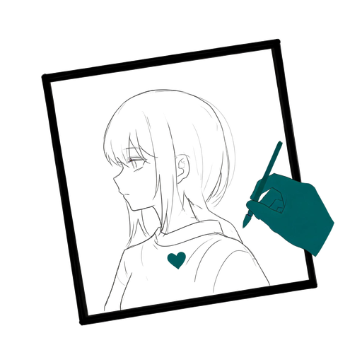

<p align="center">
  
</p>

<h1 align="center">Live2D Master Agent</h1>

<p align="center">
  <strong>用一句话，让 AI 帮你生成一个能动的二次元角色。</strong><br>
  从文本描述 → AI 立绘 → 自动分层 → Live2D 模型 → 可导出可预览。
</p>

<p align="center">
  <a href="https://github.com/mw2wbyys6t-sudo/live2d-auto-pipeline/releases"></a>
  <a href="LICENSE"></a>
<a href="https://app.fossa.com/projects/git%2Bgithub.com%2Fmw2wbyys6t-sudo%2Flive2d-auto-pipeline"></a>
  <a href="https://www.python.org/"></a>
  <a href="https://go.dev/"></a>
  <a href="https://nextjs.org/"></a>
</p>

---


## 先说清楚：现在能干什么

我不想给你画饼。这个项目有些部分已经很稳，有些还在路上。下面是**截至 v0.10.8 的真实状态**：

| 能力 | 状态 | 说明 |
|------|------|------|
| AI 生成角色立绘 | ✅ 可用 | Pollinations 免费云端，开箱即用无需 Key；也支持火山引擎/商汤付费高质量生成 |
| 完全离线生图 | ✅ 可用 | 断网时自动降级为占位立绘，保证流程不中断 |
| 自动分层（K-means） | ✅ 可用 | 颜色聚类分层，纯 Python 实现，无需额外模型 |
| 自动分层（SAM 语义） | ⚠️ 需配置 | 语义分割精度更高，但需下载约 2GB 模型权重 |
| PSD 导出 | ✅ 可用 | 需 `pip install psd-tools`；缺了也能降级导出 PNG 包 |
| Live2D moc3 导出 | ✅ 可用 | **自研编译器，已通过 Live2D 官方 Cubism Core 逐像素验收** |
| 面部捕捉驱动 | ✅ 安装包内置 | 桌面版用 Rust 原生面捕（YuNet + `onnxruntime.dll`），**不需要装 Python / MediaPipe**；从源码运行才走 MediaPipe。CI 已验证 exe / 模型 / dll 齐备，未接摄像头实测驱动效果 |
| 桌宠运行 | ⚠️ 未实机验证 | pygame 已随包分发，但多窗口 / 置顶行为尚未在真机验收 |
| LLM 对话 + 语音 | ⚠️ 需 Key | 对话需要 OpenAI/Anthropic API Key 或本地 Ollama |
| 离线依赖 | ✅ 安装包自带 | 嵌入式 CPython 3.12 + 92 个离线包（site-packages 约 1.4 GB），装完即可跑，无需预装 Python |

> 一句话总结：**「生成 → 分层 → 导出」核心链路完全可用，安装包装完即带运行时**；高级交互（LLM 对话）需自备 Key，面捕 / 桌宠尚待真机验证。

---

## 这个项目解决了什么问题

我自己是个技术爱好者，不是专业画师也不是建模师。我想做一个属于自己的虚拟形象，但发现：

- 找画师画一张立绘：**几百到几千块**
- 找人做 Live2D 绑定：**几千到上万块**
- 自己学：**PS 分层、Live2D Cubism、参数调试，每一样都要好几个月**

所以我写了这个项目——**把「一句话到可用的 Live2D 模型」这条路上最耗时的环节自动化**。你不需要会画画，不需要懂建模，只要描述你想要什么样的角色，剩下的交给代码。

它不能替代专业画师和建模师的精细作品，但能让你**零成本快速获得一个能用的起点**，然后在这个基础上继续打磨。

---

## 这个项目面向谁

### 适合你，如果你……

- **想做自己的虚拟形象，但不会画画** —— 有想法、描述得出想要的角色就行，不需要绘画或建模基础
- **是技术爱好者或程序员** —— 想要一条能自己改、自己扩的角色生成管线，而不是一个黑盒服务
- **在做独立作品** —— 独立游戏原型、同人企划、短片，需要几个风格一致的立绘打底
- **想搞懂 Live2D 模型是怎么组装的** —— 自研 moc3 编译器是完整可读的实现，可以当参考
- **预算为零** —— 免费链路（Pollinations 生图 + K-means 分层 + 自研 moc3 导出）不花一分钱

### 可能不适合你，如果你……

- **要商业级、能直接上镜直播的成品模型** —— 自动绑定给不了那个精度，仍需专业 Live2D 技术师手动精修
- **想照着已有角色或某张立绘复刻** —— 这个项目是从文字描述生成**新**角色，不是照图转模型
- **完全不想碰命令行和环境配置** —— 桌面应用双击安装即可用：Python 运行时、AI 生图依赖、模型都已随包分发，无需单独配环境

### 典型使用场景

| 场景 | 怎么用 | 能拿到什么 |
|------|--------|-----------|
| 造一个属于自己的虚拟形象 | 一句话描述 → 生成 → 分层 → 导出 | 可导入 Live2D Cubism / VTube Studio 的 moc3 模型包 |
| 给原型快速凑角色素材 | 换个描述多跑几次，挑满意的 | 立绘 PNG + PSD 分层文件 |
| 直播或录屏配个会动的形象 ⚠️ | 面部捕捉驱动 + 桌宠模式 | 跟着你表情动的桌面角色 |
| 学 Cubism4 模型结构 | 读 `live2d_builder/` 源码 + 跑一遍导出 | 一份能跑通的参考实现 |
| 当可继续打磨的起点 | 导出 PSD 手动改分层，再进 Cubism 精修 | 更接近成品的手工模型 |
| 离线或受限网络环境演示 | 断网自动降级占位立绘 | 流程不中断的演示效果 |

> 标 ⚠️ 的场景：面捕在安装包里是原生实现，但仍需摄像头；桌宠虽随包带了 pygame，尚未真机验收。**从源码运行**时，面捕走 MediaPipe、桌宠需自行安装 pygame。
>
> 如果你落在「可能不适合」那一栏，欢迎先提个 Issue 说清需求——项目还在快速迭代，有些边界是能推的。

---

## 快速开始

### 🖥️ 桌面应用（推荐 — 直接利用本地 GPU/CPU）

> **v0.10.5 起全面转向桌面应用**。Docker 和独立 Web 部署已废弃，桌面应用成为唯一分发形态。

**下载安装包**（Windows，双击安装）：

👉 [最新 Release v0.10.8](https://github.com/mw2wbyys6t-sudo/live2d-auto-pipeline/releases/tag/v0.10.8)

| 下载文件 | 说明 |
|----------|------|
| `Live2D.Master.Agent_0.10.8_x64-setup.exe` | **Windows 安装包（NSIS，约 484 MB）** — 双击安装，装完即可用 |

> ✅ 本版安装包**自带完整运行时**：嵌入式 CPython 3.12 + 全量离线依赖（含 CPU 版 torch、mediapipe、rembg）+ `app/` 源码树 + 原生面捕（YuNet + `onnxruntime.dll`）。**无需预装 Python**。
>
> ⚠️ 体积从旧版约 8 MB 变为约 484 MB 是正常的：旧包只含两个 exe，这正是「后端未找到」的原因。若你下载到的 setup 只有 ~8 MB，说明拿到的是旧 v0.10.7，请改用 v0.10.8。

**使用方式**：
1. 从 Release 下载 `Live2D.Master.Agent_0.10.8_x64-setup.exe`（确认约 484 MB）
2. 若之前装过旧版，先运行旧安装目录里的 `uninstall.exe`
3. 双击安装（NSIS 安装向导）；装完先确认安装目录含 `live2d-api.exe`、`python\`、`app\`、`models\`
4. 从开始菜单或桌面快捷方式启动，应用会自动拉起本地后端并打开工作台 `http://localhost:8080`

**装完自检**（可选，1 分钟）：

```powershell
# 安装目录应含这些；缺 live2d-api.exe 就是没装对
Get-ChildItem "$env:LOCALAPPDATA\Live2D Master Agent" | Select-Object Name

# 应用启动后，后端应能自报健康状态
Invoke-RestMethod http://127.0.0.1:8080/api/health | ConvertTo-Json
Invoke-RestMethod http://127.0.0.1:8080/api/diagnostics | ConvertTo-Json -Depth 6
```

仓库还带一键验收脚本：`powershell -ExecutionPolicy Bypass -File .\scripts\windows\verify_desktop_install.ps1 -Launch`

> ✅ 这套验收已在 GitHub 的 Windows runner 上对 v0.10.8 **发布包本身**实跑过，结果 `RESULT: PASS`（[run #39046077810](https://github.com/mw2wbyys6t-sudo/live2d-auto-pipeline/actions/runs/39046077810)）：安装器退出码 `0`、17 项文件齐全、随包 Python `3.12.10`、`torch` / `mediapipe` 可导入、`/api/health` 返回 `python_ok=true`。

> 🔏 **关于代码签名**：当前安装包**尚未签名**，Windows 首次运行会提示 SmartScreen「未知发布者」——点「更多信息 → 仍要运行」即可。请用 SHA256 确认文件完整：
>
> ```powershell
> (Get-FileHash ".\Live2D.Master.Agent_0.10.8_x64-setup.exe" -Algorithm SHA256).Hash
> # 期望：01862574322E45410ECAD57587BCDCE7413E968387B267FE1FDF8A4D605B71B5
> ```
>
> 签名管线已就绪（[scripts/windows/sign_artifacts.ps1](scripts/windows/sign_artifacts.ps1)，支持自定义签名命令 / PFX / 证书指纹）。获得受信任证书后，设置仓库变量 `L2D_SIGN_MODE=required` 并配置对应密钥，构建即自动签名并在签名无效时**阻断发布**。

### v0.10.8 更新内容（先看这 5 条）

1. **安装包自带运行时（461.62 MiB）**：内含嵌入式 CPython 3.12 + 92 个离线包（site-packages 约 1.4 GB）+ `app/` 源码树 + 原生面捕 + YuNet 模型，**不用再装 Python**。旧版 8 MB 包只含两个 exe，这正是「后端未找到」的根因。
2. **修复导出页 PSD 100% 失败**：前端此前只读内层 `data.success`，而该字段本就不存在；现在改为合并外层 envelope 判断。
3. **界面少了几个控件**：生成页 Provider / 风格 / Steps / CFG，导出页 Include physics / expressions / motions 与 Compression，Live2D 页模型结构树 / Physics 面板 / Wireframe —— 后端从未消费，属「改了也没效果」的假开关，本版移除。
4. **不再有假成功**：导出 PSD、角色保存/删除、See-through、LLM 兜底回复、Python 面捕，以前失败也可能显示成功；现在失败会明确报错（See-through 无抠图能力直接返回 **501**，面捕启动失败返回 **503**）。
5. **可自检了**：新增 `/api/diagnostics`（逐项报告解释器、依赖、模型、输出目录）与一键验收脚本 `scripts/windows/verify_desktop_install.ps1`。

> 完整变更、**尚未验证项**与发布证据（源码提交 / 构建运行 / 哈希 / 回滚目标）见 [CHANGELOG v0.10.8](CHANGELOG.md)。旧版 v0.10.7 的 8 MB 安装包已从 Release 撤下。

### 命令行快速体验（30 秒核心能力）

```bash
# 安装依赖
pip install -r requirements.txt

# 一句话生成角色（用免费的 Pollinations，不需要任何 API Key）
python -m core.cli generate "蓝发猫耳少女，白色背景，日系赛璐璐风格"

# 交互式菜单
python -m core.cli
```

就这么简单。如果你的网络能访问 pollinations.ai，几十秒内你就能在 `output/` 目录看到生成的角色立绘。

### 从源码构建桌面应用

**产出可分发安装包**（与 Release 一致，自带运行时）：

```bash
# 前置：Node.js 20+、Go 1.25+、Rust stable、Python 3.12、tauri-cli（cargo install tauri-cli）

# 1) 前端 + Go 后端 + Rust 面捕
cd web && npm ci && npm run build && cd ..
cd api && go build -trimpath -ldflags "-s -w -H windowsgui" -o live2d-api.exe . && cd ..
cd native/face_tracker && cargo build --release && cd ../..

# 2) 装配自带运行时（嵌入式 Python / 离线 wheel / 模型，约 1.4 GB site-packages）
python scripts/build_desktop_bundle.py --go-exe api/live2d-api.exe \
  --face-tracker-exe native/face_tracker/target/release/face_tracker.exe

# 3) 打 NSIS 安装包
cd desktop && cargo tauri build --bundles nsis
# 产物：desktop/target/release/bundle/nsis/Live2D Master Agent_<version>_x64-setup.exe
```

**只想要一个轻量 exe 调试**（不含运行时，需本机 Python 3.11+）：

```bash
./scripts/build_desktop.sh
# 产物：dist/Live2DMasterAgent.exe（无控制台）/ dist/Live2DMasterAgent-console.exe（带日志）
```

> 注意：这个轻量 exe 只是窗口壳，必须配合本机 Python 与依赖才能跑；分发给别人请用上面的 NSIS 安装包。

### 开发模式（前后端分离调试）

需要两个终端：

```bash
# 终端 1 — 启动 Python 后端（端口 8080）
python api_server.py

# 终端 2 — 启动前端开发服务器
cd web && npm install && npm run dev
```

开发模式下打开 **http://localhost:3000**，前端通过 rewrites 代理连接后端。

---

## 核心流程

```
你的描述          AI 生图           自动分层          导出
  │                │                │               │
  ▼                ▼                ▼               ▼
"蓝发猫耳少女" → 立绘 PNG → 18 层 PSD → .moc3 模型包
                                    ↓
                              可导入 Live2D Cubism
                              可导入 VTube Studio
```

### AI 图像生成

接入多个服务商，按优先级自动降级：

| 优先级 | 服务 | 需要付费？ | 质量 |
|--------|------|-----------|------|
| 1 | Seedream（火山引擎） | 需 Key | 高 |
| 2 | SenseNova（商汤） | 需 Key | 高 |
| 3 | OpenAI 兼容端点 | 需 Key | 取决于模型 |
| 4 | **Pollinations.ai** | **免费** | 中 |
| 5 | 本地占位图 | 免费 | 兜底用 |

不配任何 Key，默认走 Pollinations，完全够用。

### 自动分层

两种模式：

- **K-means 颜色聚类**（默认，纯 Python）：按颜色相近度自动拆分图层，快且不需要额外依赖。
- **SAM + ISNet 语义分割**（需下载模型）：按语义识别头发、五官、衣物等部位，精度更高但需要约 2GB 模型权重。运行 `python scripts/download_models.py` 下载。

标准 18 层顺序：头皮 → 后发 → 中发 → 前发 → 眉毛 → 眼睛 → 口鼻 → 脸 → 颈 → 上衣 → 内衣 → 手臂 → 手 → 裙摆 → 腿 → 配饰 → 兽耳/尾 → 特效。

### Live2D moc3 导出

这是项目里我花了最多心血的部分。

不是调用外部工具，而是**自己写了 moc3 编译器**——从分层 PNG 直接编译出符合 Live2D Cubism4 规范的 `.moc3` 文件，包含网格、骨骼、变形器、28 个表情参数、物理模拟。

> ✅ 已在 **Live2D 官方 Cubism Native Core** 上通过逐像素验收：导出的模型能被官方内核正确加载，参数确实驱动画面。测试规模 504 passed / 96 skipped（2026-10-17 CI 实测）。

---

## 项目结构

```
├── core/                  Python 核心内核
│   ├── image_gen/           图像生成（多服务商路由 + 离线兜底）
│   ├── segment_engine/      分层引擎（K-means / SAM / ISNet）
│   ├── psd/                 PSD 读写
│   ├── qa/                  质量检测
│   └── workflow.py          全流程编排
├── live2d_builder/        Live2C Cubism4 构建管线
│   ├── mesh/                网格生成
│   ├── bones/               骨骼 + 变形器
│   ├── blendshapes/         28 表情参数
│   ├── physics/             物理模拟
│   └── exporter/            自研 moc3 编译器 ← 核心技术
├── drivers/               实时驱动层
│   ├── face_tracker/        MediaPipe 面部捕捉
│   ├── desktop_pet/         桌宠
│   └── live2d_runtime/      软件 Live2D 渲染
├── llm_bridge/            AI 对话网关
├── api/                   Go REST API（Gin）
├── web/                   Next.js 工作台（8 页面）
├── desktop/               Tauri v2 外壳（窗口 + 拉起后端 + NSIS 打包）
├── native/face_tracker/   Rust 原生面捕（YuNet + onnxruntime）
├── scripts/               装配与验收（build_desktop_bundle.py、windows/verify_desktop_install.ps1）
├── assets/icon/           项目图标
└── docs/                  文档
```

---

## 配置（可选）

默认零配置即可使用核心功能。如果你想要更高质量的生图或对话能力：

```bash
cp .env.example .env
```

编辑 `.env`，按需填入：

```env
# 高质量生图（可选，不填就用免费的 Pollinations）
ARK_API_KEY=你的火山引擎Key
SENSENOVA_API_KEY=你的商汤Key

# LLM 对话（可选，不填则聊天功能不可用）
OPENAI_API_KEY=sk-你的Key
OPENAI_BASE_URL=https://api.openai.com/v1
LLM_MODEL=gpt-4o-mini

# 或者用本地 Ollama（完全免费）
# 启动 ollama serve && ollama pull qwen2.5:3b 即可，无需填 Key
```

> `.env` 文件已被 `.gitignore` 排除，不会上传到 GitHub。

---

## 已知局限

与其让你踩坑后失望，不如提前说清楚：

1. **生成的角色质量取决于 AI 生图服务商**。免费的 Pollinations 出图质量中等；想要高质量赛璐璐立绘，建议配置火山引擎 Seedream。
2. **SAM 语义分层需要约 2GB 模型权重**。不想下载的话，默认的 K-means 分层也够用。
3. **面部捕捉依赖摄像头**：安装包内置原生面捕（YuNet + onnxruntime），CI 已验证程序、模型、运行库齐备且诊断项通过，但**未接摄像头实测驱动效果**；桌宠的多窗口 / 置顶行为同样未验证。
4. **moc3 导出的模型是「可用但粗糙」的起点**。自动绑定无法替代专业 Live2D 技术师的手动精调——它能让你快速有一个能动的模型，但要追求商业级品质仍需人工打磨。
5. **项目仍在快速迭代中**，API 接口可能随版本变化。
6. **Windows 安装包未签名**：首次运行会触发 SmartScreen「未知发布者」提示；请用上面给出的 SHA256 校验下载完整性。
7. **安装包体积 306 MiB**：因为内置了完整 Python 运行时与模型，这是「装完就能用」的代价；对比旧版 8 MB（只含两个 exe，缺运行时）。

详细说明见 [docs/LIMITATIONS.md](docs/LIMITATIONS.md)。

---

## 测试

```bash
# Python 测试（504 passed / 96 skipped，2026-10-17 构建实测；跳过的多为缺可选依赖）
python -m pytest tests/ -v

# Go 测试
cd api && go test ./... -v

# 前端构建检查
cd web && npm run build
```

---

## 版本记录

| 版本 | 日期 | 重点 |
|------|------|------|
| **v0.10.8** | 2026-10-17 | **Honest Desktop**：安装包自带运行时（461.62 MiB / 92 个离线包，无需装 Python）、修复「后端未找到」与导出页 PSD 失败、移除无效控件与假成功、新增 `/api/diagnostics` 与一键验收脚本（未签名） |
| **v0.10.7** | 2026-10-16 | **依赖治理 + 发布修复**：抬高 Python/npm 依赖下限消除 CVE 面、修复 Release 无资产回归、清零版本号漂移（⚠️ 该版 8 MB 安装包缺运行时，已撤下） |
| **v0.10.6** | 2026-10-15 | **CI 修复 + 版本统一**：关闭 pixi.js v8 破坏性升级 PR、dependabot 忽略 major、全栈版本号对齐到 0.10.6 |
| **v0.10.5** | 2026-10-11 | **Desktop First**：移除 Docker/Web 部署，全面转向桌面应用；桌面应用安装包可直接下载 |
| **v0.10.4** | 2026-10-11 | **Hardened Shell**：5 项安全加固（CSP/面捕恢复、zip symlink 防护、目录列举禁用、SSRF DNS 钉扎、PNG 批量导入内存优化） |
| v0.10.3 | 2026-10-08 | 沙箱就绪：离线兜底生图 + PSD 缺依赖不崩 + 健康检查真实化 + 端口冲突友好提示 |
| v0.10.2 | 2026-09-29 | 离线兜底生成器 + PSD 图层命名 + 桌面打包工具链 |
| v0.10.1 | 2026-09-22 | 自研 moc3 编译器：官方 Cubism 参数驱动 + 逐像素验收通过 |
| v0.10.0 | 2026-09-22 | SAM 语义分层 + 完整 Cubism4 模型包 + MediaPipe 面捕 + LLM 对话 |

完整记录见 [CHANGELOG.md](CHANGELOG.md)。

---

## 文档

| 文档 | 内容 |
|------|------|
| [快速入门](docs/QUICKSTART.md) | 5 分钟跑通 |
| [用户指南](docs/USER_GUIDE.md) | 完整功能说明 |
| [常见问题](docs/FAQ.md) | 遇到问题先看这里 |
| [已知局限](docs/LIMITATIONS.md) | 功能边界 |
| [架构设计](docs/ARCHITECTURE.md) | 技术架构详解 |
| [架构决策](docs/architecture/index.md) | 6 条核心 ADR + 架构不变量 |
| [部署指南](docs/DEPLOY.md) | 桌面应用安装与构建 |

---

## 关于这个项目

这个项目由一个人从零开始摸索着做出来。我不是科班出身，很多技术是边做边学的——所以代码里可能有不够优雅的地方，架构上也有可以改进的空间。

但它解决了一个真实的问题：**让没有绘画和建模基础的人，也能拥有自己的虚拟形象。**

如果你也在做类似的事情，或者对这个方向感兴趣，欢迎交流。

---

## 如何贡献

欢迎所有形式的贡献：

- **提交 Issue** — 反馈 Bug、提功能建议
- **Pull Request** — 修 Bug、加功能、改文档
- **分享作品** — 用这个项目生成的角色（保留署名即可）
- **写教程** — 帮更多小白上手

提交 PR 前请确保 `pytest tests/` 和 `npm run build` 通过。详见 [docs/CODE_STANDARD.md](docs/CODE_STANDARD.md)。

---

## 致谢

这个项目站在巨人的肩膀上：

- [MediaPipe](https://mediapipe.dev/) — 面部捕捉
- [Segment Anything](https://github.com/facebookresearch/segment-anything) — 语义分割
- [pixi-live2d-display](https://github.com/nicxfer/pixi-live2d-display) — Web Live2D 渲染
- [Pollinations.ai](https://pollinations.ai) — 免费 AI 生图
- [Live2D Cubism](https://www.live2d.com/) — 官方规范参考

感谢每一位 Star、Issue、PR 的贡献者。

---

## 许可证

[Apache-2.0](LICENSE) — 商业用途也欢迎。
